# HireFlow — Sơ Đồ Cơ Sở Dữ Liệu (Entity Relationship Diagram - ERD)

Tài liệu này thể hiện cấu trúc Cơ sở dữ liệu quan hệ của hệ thống **HireFlow** chạy trên **Microsoft SQL Server**, được quản lý đồng bộ thông qua **Entity Framework Core 8 Code-First**.

---

## 1. Sơ Đồ Thực Thể Quan Hệ (Mermaid ERD)

> *Ghi chú: Khi mở file này trên GitHub, GitHub sẽ tự động render đoạn mã bên dưới thành sơ đồ đồ họa trực quan.*

```mermaid
erDiagram
    User ||--o| FreelancerProfile : "has (UserId)"
    User ||--o| EmployerProfile : "has (UserId)"
    User ||--o| CreditWallet : "owns (UserId)"
    User ||--o{ FreelancerDocument : "uploads (FreelancerId)"
    User ||--o{ Project : "publishes (EmployerId)"
    User ||--o{ Application : "submits (FreelancerId)"
    User ||--o{ SavedProject : "bookmarks (FreelancerId)"
    User ||--o{ ContactUnlock : "unlocks (FreelancerId)"
    User ||--o{ CreditPurchase : "purchases (UserId)"
    User ||--o{ UserNotification : "receives (UserId)"
    User ||--o{ Report : "reports (ReporterId)"
    User ||--o{ AuditLog : "triggers (UserId)"

    FreelancerProfile ||--o{ FreelancerSkill : "has skills"
    
    Project ||--o{ ProjectSkill : "requires skills"
    Project ||--o{ Application : "receives"
    Project ||--o{ SavedProject : "saved by"
    Project ||--o{ Conversation : "has chat"

    FreelancerDocument ||--o{ Application : "attached as CV"

    Application ||--o{ ApplicationStatusHistory : "tracks timeline"

    CreditWallet ||--o{ CreditTransaction : "logs transactions"
    
    CreditPackage ||--o{ CreditPurchase : "selected package"

    Conversation ||--o{ ChatMessage : "contains messages"

    User {
        int UserId PK
        string Email UK
        string PasswordHash
        string FullName
        string Role "Freelancer | Employer | Admin"
        bool IsActive
        datetime CreatedAt
        datetime UpdatedAt
    }

    FreelancerProfile {
        int ProfileId PK
        int UserId FK
        string Headline
        string Bio
        int ExperienceYears
        string Location
        datetime UpdatedAt
    }

    EmployerProfile {
        int EmployerProfileId PK
        int UserId FK
        string CompanyName
        string PublicDisplayName
        string ContactEmail
        string ContactPhone
        string Website
        string Address
    }

    Project {
        int ProjectId PK
        int EmployerId FK
        string Title
        string Description
        decimal BudgetMin
        decimal BudgetMax
        string CurrencyCode "VND"
        string ExperienceLevel
        datetime Deadline
        string Status "Open | Closed | Hidden | Removed"
        datetime CreatedAt
        datetime PublishedAt
    }

    Application {
        int ApplicationId PK
        int ProjectId FK
        int FreelancerId FK
        int DocumentId FK
        string CoverLetter
        string Status "Pending | Reviewing | Shortlisted | Accepted | Rejected | Withdrawn"
        datetime AppliedAt
        datetime UpdatedAt
    }

    SavedProject {
        int SavedProjectId PK
        int FreelancerId FK
        int ProjectId FK
        datetime SavedAt
    }

    FreelancerDocument {
        int DocumentId PK
        int FreelancerId FK
        string OriginalFileName
        string StorageKey
        string ContentType "application/pdf"
        long FileSize
        string ContentHash
        bool IsDefault
        datetime UploadedAt
        bool IsDeleted
    }

    CreditWallet {
        int WalletId PK
        int UserId FK
        int Balance
        datetime UpdatedAt
        byte RowVersion "Concurrency Token"
    }

    CreditTransaction {
        int TransactionId PK
        int UserId FK
        int Amount
        string TransactionType "ApplicationFee | ContactUnlock | ProjectPublish | Refund | CreditPurchase"
        string ReferenceType
        string ReferenceId
        string Description
        datetime CreatedAt
    }

    ContactUnlock {
        int ContactUnlockId PK
        int FreelancerId FK
        int EmployerId FK
        int ProjectId FK
        datetime UnlockedAt
    }

    ApplicationStatusHistory {
        int HistoryId PK
        int ApplicationId FK
        string OldStatus
        string NewStatus
        int ChangedByUserId FK
        datetime ChangedAt
    }

    UserNotification {
        int NotificationId PK
        int UserId FK
        string Title
        string Message
        string Type
        int ReferenceId
        bool IsRead
        datetime CreatedAt
    }
```

---

## 2. Danh Sách Các Bảng & Ràng Buộc Khóa (Constraints)

| Bảng (Table) | Mục đích | Khóa chính (PK) | Khóa ngoại (FK) | Ràng buộc duy nhất (Unique) |
|---|---|---|---|---|
| **Users** | Lưu trữ tài khoản và phân quyền | `UserId` | Không | `UNIQUE(Email)` |
| **FreelancerProfiles** | Hồ sơ năng lực & kinh nghiệm | `ProfileId` | `UserId` -> `Users` | `UNIQUE(UserId)` |
| **EmployerProfiles** | Thông tin công ty & liên hệ bảo mật | `EmployerProfileId` | `UserId` -> `Users` | `UNIQUE(UserId)` |
| **Projects** | Tin dự án/việc làm cần tuyển | `ProjectId` | `EmployerId` -> `Users` | Index theo `Status`, `CreatedAt` |
| **ProjectSkills** | Kỹ năng yêu cầu cho dự án | `ProjectSkillId` | `ProjectId` -> `Projects` | Composite Index `(ProjectId, SkillName)` |
| **FreelancerDocuments** | Metadata tệp CV PDF bảo mật | `DocumentId` | `FreelancerId` -> `Users` | Kiểm tra định dạng `magic bytes %PDF-` |
| **Applications** | Hồ sơ ứng tuyển của Freelancer | `ApplicationId` | `ProjectId`, `FreelancerId`, `DocumentId` | `UNIQUE(ProjectId, FreelancerId)` |
| **SavedProjects** | Danh sách dự án yêu thích/đã lưu | `SavedProjectId` | `FreelancerId`, `ProjectId` | `UNIQUE(FreelancerId, ProjectId)` |
| **CreditWallets** | Số dư credit tài khoản | `WalletId` | `UserId` -> `Users` | `UNIQUE(UserId)`, Concurrency `RowVersion` |
| **CreditTransactions** | Sổ cái biến động credit | `TransactionId` | `UserId` -> `Users` | Lịch sử giao dịch nguyên tử |
| **ContactUnlocks** | Bản quyền mở khóa thông tin NTD | `ContactUnlockId` | `FreelancerId`, `EmployerId` | `UNIQUE(FreelancerId, EmployerId)` |
| **ApplicationStatusHistories**| Lịch sử thay đổi trạng thái hồ sơ | `HistoryId` | `ApplicationId`, `ChangedByUserId` | Lưu vết thời gian UTC |
| **UserNotifications** | Thông báo biến động trong hệ thống | `NotificationId` | `UserId` -> `Users` | Hỗ trợ polling & thông báo thời gian thực |
