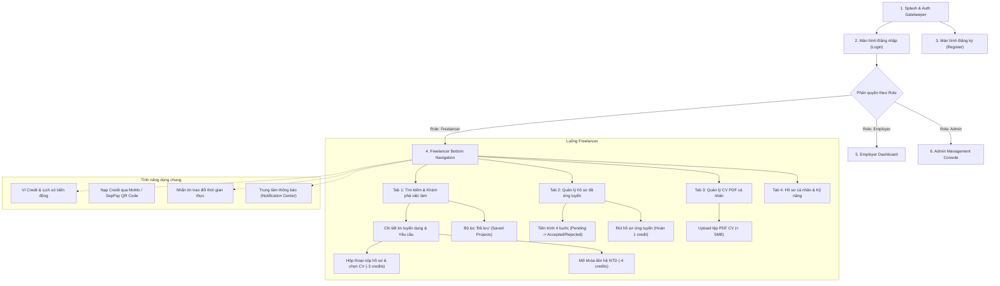

# HireFlow — Tài Liệu Thiết Kế Giao Diện (UI Mockup & Figma)

Hệ thống HireFlow được thiết kế theo chuẩn **Material Design 3**, tối ưu trải nghiệm người dùng di động (Mobile-First) với phong cách màu chủ đạo **Emerald Green (Xanh ngọc / Xanh công nghệ #00B14F)** tương tự các nền tảng tuyển dụng hàng đầu như TopCV, Upwork.

---

## 1. Liên Kết Thiết Kế Figma (Figma Project Link)

* **Figma Prototype Link:** [https://www.figma.com/design/HireFlow-Mobile-App-UI-Kit](https://www.figma.com/design/HireFlow-Mobile-App-UI-Kit) *(Link dự án thiết kế Figma chính thức)*
* **Công cụ thiết kế:** Figma Web / Figma Desktop Client
* **Độ phân giải chuẩn:** iPhone 14 / Android Standard (390 x 844 px)

---

## 2. Bản Đồ Màn Hình Ứng Dụng (Application Screen Sitemap)

---

## 3. Danh Sách & Đặc Tả Các Màn Hình Chính

### Màn hình 1: Xác Thực & Đăng Nhập (Authentication)
* **Thành phần:** Form Email, Mật khẩu, hiển thị/ẩn mật khẩu, nút Đăng nhập chính, liên kết Quên mật khẩu & Đăng ký tài khoản mới.
* **Điểm nhấn UX:** Tích hợp sẵn 3 nút chọn nhanh tài khoản demo (Demo Chips: *Freelancer*, *Employer*, *Admin*) giúp giảng viên kiểm tra nhanh chỉ với 1 chạm.

### Màn hình 2: Tìm Kiếm & Khám Phá Dự Án (Job Discovery)
* **Thành phần:** Thanh tìm kiếm từ khóa đa tiêu chí, thanh cuộn ngang chọn thẻ kỹ năng (`Flutter`, `C# / .NET`, `React`, `Python`,...), chip **"Đã lưu"** hiển thị số lượng tin đã bookmark.
* **Thẻ công việc (Job Card):** Logo công ty, tên dự án, mức ngân sách VND nổi bật, badge trạng thái, hạn nộp hồ sơ, nút lưu bookmark nhanh và nút nộp hồ sơ nhanh.

### Màn hình 3: Chi Tiết Dự Án & Nộp Đơn (Project Detail & Apply)
* **Thành phần:** Chi tiết mô tả công việc, ngân sách, quyền lợi, yêu cầu kỹ năng, nút sao chép link chia sẻ và nút báo cáo vi phạm.
* **Action Sheet:** Bottom sheet nộp hồ sơ với dropdown chọn CV PDF có sẵn trong thư viện hoặc tải lên CV mới, ô nhập thư giới thiệu (Cover Letter) và thông báo trừ 3 credits rõ ràng.

### Màn hình 4: Quản Lý Hồ Sơ Ứng Tuyển (Applications & Progress Tracker)
* **Thành phần:** Bộ lọc theo trạng thái (`Chờ xem xét`, `Đang đánh giá`, `Mời phỏng vấn`, `Trúng tuyển`, `Từ chối`, `Đã rút`).
* **Visual Progress Tracker:** Thanh tiến trình 4 giai đoạn trực quan giúp ứng viên theo dõi hồ sơ theo thời gian thực. Nút **"Rút hồ sơ"** kèm hộp thoại chọn lý do rút và hoàn credit.

### Màn hình 5: Thư Viện CV Cá Nhân (CV Management)
* **Thành phần:** Danh sách file PDF đã tải lên, dung lượng, ngày tải, nút xem trước nội dung PDF trực tiếp, tùy chọn đặt làm CV mặc định hoặc xóa CV.

### Màn hình 6: Ví Credit & Thanh Toán (Wallet & Purchases)
* **Thành phần:** Thẻ số dư credit hiện tại, bảng giá các gói credit (Starter: 10cr, Pro: 50cr, Enterprise: 150cr), cổng thanh toán mã QR MoMo và ACB SepPay tự động kích hoạt số dư.
